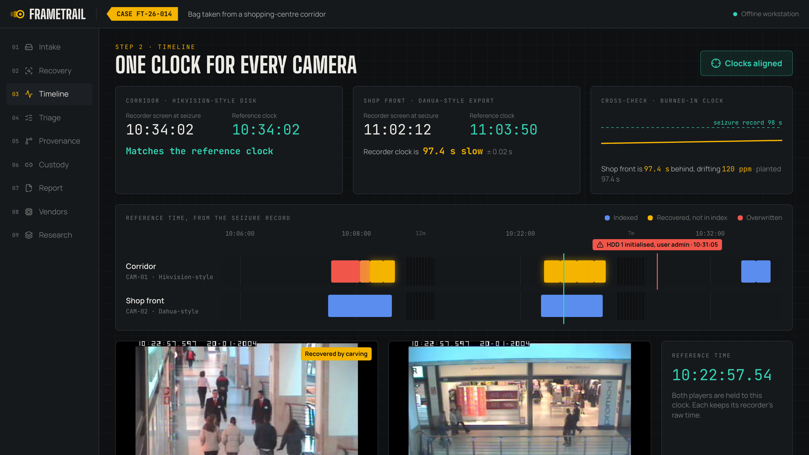

<h1 align="center">FrameTrail</h1>

<p align="center">Every frame, traced to its source bytes.</p>

<p align="center"></p>

FrameTrail reads a seized DVR disk and an NVR export side by side, offline and read-only.
When someone has wiped the recorder, it finds the wipe in the recorder's own log and in time running backwards across the disk, then carves back the footage the format left behind.
Every clip it exports traces to the exact bytes it came from, with MD5 and SHA-256 at every step and a hash-chained custody log.

| On the demo case | Result |
|---|---|
| Footage carved back after the wipe | 7 segments, 99.4 s |
| Recorded over, reported as lost | 30.0 s |
| Disk initialisation | Dated to 10:31:05 from 5 independent clues |
| NVR clock offset | 97.4 s found, 97.4 s planted, 120 ppm drift |
| Exported clips identical to their source frames | 11 of 11 |
| Custody events, hash-chained | 18 |

The footage is real CCTV from the CAVIAR project (CC BY-SA), packed into synthetic recorder images modelled on published disk layouts.
FrameTrail has not yet been run on a seized recorder, and [docs/validation.md](docs/validation.md) says what that means.

## Install

You need Node 20.9 or later, pnpm 10, [uv](https://docs.astral.sh/uv/) and FFmpeg on your PATH.
uv fetches Python 3.12 for the engine if you do not have it.

```sh
pnpm install --frozen-lockfile    # web app, from pnpm-lock.yaml
pnpm engine:setup                 # engine, from engine/uv.lock
```

## Run

```sh
pnpm build && pnpm start   # http://localhost:3150
```

`data/demo/derived/case.json` is committed, so the workbench runs straight after install.
The video players stay empty until you build the evidence and run the case, which writes the clips to `data/local/clips/`.

```sh
pnpm engine:fixtures   # download 43 MB of CAVIAR footage, build both evidence files into data/local
pnpm engine:analyse    # run the case, rewrite data/demo/derived/case.json, export the clips
```

The engine logs each step to stderr and prints the case stats to stdout.
`uv run --project engine frametrail --log-format json analyse` writes the steps as one JSON object per line instead.
A missing or malformed input stops the run with `frametrail: error:` and the file or field to fix, and exits 2.

## Docker

```sh
docker compose up --build web              # the workbench on http://localhost:3150
docker compose run --rm engine fixtures    # download the footage, build the evidence into data/local
docker compose run --rm engine analyse     # run the case, rewrite data/demo/derived/case.json
```

One `Dockerfile` builds two targets, `web` and `engine`, and both mount `./data`.
The workbench reads the case on every request, so an engine run shows without a rebuild.
Its healthcheck calls `GET /health`, which answers 503 when `case.json` is missing or broken.
`.dockerignore` keeps `.env.local` out of the build, so an image always shows the neutral names.

## Test

```sh
pnpm test          # web tests, then engine tests, each with its coverage floor
pnpm engine:test   # engine tests with coverage, failing under 80 percent
pnpm engine:lint   # ruff check and ruff format --check
pnpm engine:typecheck   # mypy over the engine
pnpm check         # private names, typecheck, Biome lint and format check
pnpm test:unit     # web screen and helper tests in vitest, failing under 90 percent of lines
pnpm test:e2e      # browser checks on every screen and /health, against a running `pnpm start`
```

`pnpm test:unit` renders every screen with Testing Library in jsdom, from the committed demo case and with no network.
Its coverage counts every file in `apps/web/src/lib/` and `apps/web/src/components/`, loaded or not, and fails under 90 percent of lines or 80 percent of branches.

The engine tests need no download.
`engine/frametrail/fixture/synthetic.py` builds a 6 MB disk and a 1.4 MB export in about 5 seconds, with the clock burned into frames it draws itself.
The tests carve that disk, date the tail whose head was recorded over, reject the decoy header, find the wipe and check the custody chain.
Three more tests in `engine/tests/test_caviar.py` run on the real footage and skip until `pnpm engine:fixtures` has built it.

### Verify a fresh clone

```sh
pnpm verify
```

`scripts/verify-fresh-clone.sh` clones the committed HEAD into an empty temporary folder and runs every step above there.
It installs from both lockfiles, then runs `pnpm check`, the engine lint and typecheck, both test suites and the production build.
It stops at the first failing step with the end of its log, and deletes the clone either way unless you pass `--keep`.
A passing run ends like this, in about two minutes:

```
Web coverage
Statements   : 94.1% ( 639/679 )
Branches     : 87.82% ( 548/624 )
Functions    : 93.82% ( 228/243 )
Lines        : 95.63% ( 526/550 )

Engine coverage
TOTAL                                 1281    120    91%
89 passed, 3 skipped in 33.02s

All steps passed.
```

The three skips are the CAVIAR footage tests.

CI in `.github/workflows/ci.yml` runs all of the above on every push and pull request, plus pip-audit, `pnpm audit` and a gitleaks scan of the full history.

## Configuration

Nothing needs configuring to run, test or build.
`apps/web/.env.example` lists every variable the code reads, with its default.
Copy it to `apps/web/.env.local`, which git ignores, to set display names or point the screens at another `case.json` with `FT_CASE`.

## Architecture

```
engine/        Python engine: intake, vendor detection, index and log parsing, carving,
               clock model, detection, provenance, custody, fixture builders, tests
apps/web/      Next.js workbench, one screen per step of the examination
data/demo/     case.json, the analysed demo case the web app reads
recording/     Playwright script that records the demo video
scripts/       Checks run before every commit
docs/          Architecture, SOP, validation, OEM comparison, user manual, fixtures
```

The engine reads the evidence read-only and writes one file, `case.json`, plus the exported clips.
The workbench reads only those, so everything on screen traces to one analysis run.
[docs/architecture.md](docs/architecture.md) walks through each module and the pipeline.

## Contributing

[CONTRIBUTING.md](CONTRIBUTING.md) covers the setup, the checks to run before a commit and the commit format.

## Docs

- [Architecture](docs/architecture.md)
- [Standard operating procedure](docs/sop.md)
- [Validation](docs/validation.md)
- [OEM comparison](docs/oem-comparison.md)
- [User manual](docs/user-manual.md)
- [The two evidence fixtures](docs/fixtures.md)

## Credits

Footage: EC Funded CAVIAR project/IST 2001 37540, found at http://homepages.inf.ed.ac.uk/rbf/CAVIAR/, used under CC BY-SA and not included in this repository.
Person detection: YOLOX-S by Megvii, Apache-2.0.
The disk layout follows Han, Jeong and Lee (2015), and the `.dav` framing follows FFmpeg's dhav demuxer.

Built by a student team at Saveetha Engineering College, Chennai.
Code under the [MIT licence](LICENSE).
